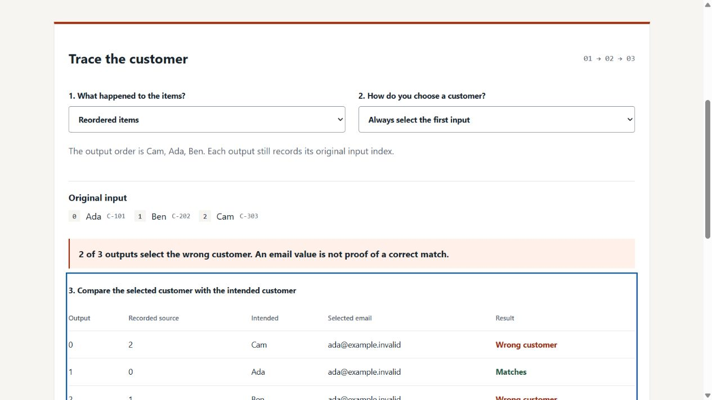

# Item Linking Lab

[Use the tool](https://aitoolcast.com/tools/item-linking-lab/) · [Try the filtered-customer walkthrough](https://aitoolcast.com/articles/n8n-item-linking-filter-output-position/?utm_source=github&utm_medium=referral&utm_campaign=item-linking-example) · [AI Toolcast](https://aitoolcast.com/)

A free local educational exercise for n8n builders: compare selecting the first input, selecting by output position and following explicit item links. Four synthetic scenarios cover reordering, filtering, a missing link and an aggregate with multiple sources.

This is a **teaching model**, not the n8n engine, a workflow validator, or a tested n8n deployment. It does not accept workflow uploads or execute expressions. The displayed expressions illustrate the lookup choice; they are not evaluated.

## Run

Run `python serve.py`, then open `http://127.0.0.1:8770/`. No package installation is required. The preview binds only to your computer and serves JavaScript modules with the correct MIME type on Windows. Run the deterministic model checks with `node --test model.test.mjs`.

Try **Reordered items → Always select the first input**, then **Follow the recorded link**. Two wrong customers become three correct matches in this constructed example. The missing-link and combined-item scenarios demonstrate why retrieving a value is not enough. Download the selected example as JSON to inspect its exact result.

## Method and limits

Three fictional customers use reserved `.invalid` email domains. Each scenario declares intended identity separately from its explicit source-index metadata. The model resolves a single source or reports missing/ambiguous links. For combined items, there is deliberately no single intended identity.

n8n also handles automatic item linking in some cases. This model starts **after** that stage, with the links displayed in the table. It does not predict automatic inference, multiple inputs, branches, loop/run indexes, error handling, subworkflows, or production recipient correctness. Metadata can itself be wrong. No model performance, client data, customer acceptance or platform certification is claimed.

The tool makes no API/model calls, stores no data, and includes no analytics. The hosting provider may log requests or measure page visits; these are not completed-task metrics. Static files are requested from the serving host; source links navigate to third-party sites. Download uses a local browser Blob. AI Toolcast developed this original implementation with AI assistance. Not affiliated with or endorsed by n8n. MIT licensed.

## Primary references

Documentation reviewed November 15, 2026:

- [Automatic item linking](https://docs.n8n.io/build/work-with-data/reference-data/link-data-items/how-items-link-through-workflows/)
- [Preserving linking in the Code node](https://docs.n8n.io/build/work-with-data/reference-data/link-data-items/preserving-linking-in-the-code-node/)
- [Item linking errors](https://docs.n8n.io/build/work-with-data/reference-data/link-data-items/item-linking-errors/)

No third-party implementation code or paid kit files are included. See [CHANGELOG.md](CHANGELOG.md) for version history. Bug reports and corrections are welcome through GitHub issues; no custom workflow support or promised future updates.
